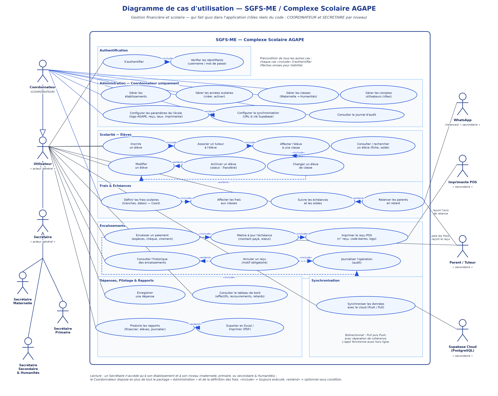
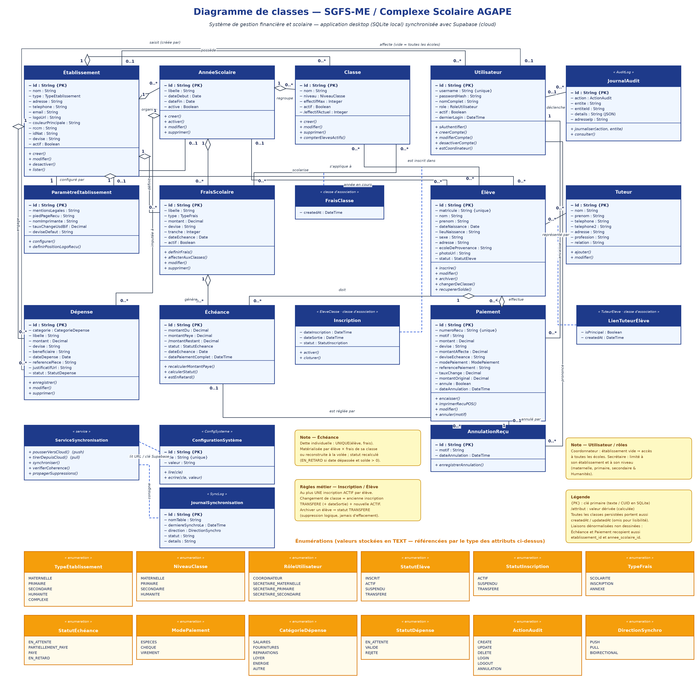

# Diagrammes UML — SGFS-ME pour le Complexe Scolaire AGAPE

> **Objet** : diagramme de **cas d'utilisation** et diagramme de **classes** de l'application
> SGFS-ME (Système de Gestion Financière et Scolaire Multi-Établissements) dans sa déclinaison
> pour le **Complexe Scolaire AGAPE** (couleur bleu `#1e3a8a`, niveaux Maternelle, Primaire,
> Secondaire et **Humanités** — voir `worklog.md`, tâche 9).
>
> Les deux diagrammes ont été construits **à partir du code réel du projet** (et non d'un
> cahier des charges théorique) :
> - modèles de données : `src-tauri/src/db/models.rs`, `src-tauri/src/db/mod.rs`, `supabase_schema.sql`
> - opérations métier : commandes Tauri `src-tauri/src/commands/*.rs`
> - rôles et permissions : `src/lib/store.ts`, `src/components/sgfs/layout/Sidebar.tsx`,
>   `src/components/sgfs/utilisateurs/UtilisateursPage.tsx`

| Fichier | Contenu |
|---|---|
| `diagramme-cas-utilisation-agape.png` / `.svg` / `.pdf` | Image du diagramme de cas d'utilisation |
| `diagramme-classes-agape.png` / `.svg` / `.pdf` | Image du diagramme de classes |
| `diagramme-cas-utilisation-agape.puml` | Source **PlantUML** (cas d'utilisation) |
| `diagramme-classes-agape.puml` | Source **PlantUML** (classes, version exhaustive : tous les attributs, y compris `createdAt`/`updatedAt`, et toutes les associations) |
| `generer_diagrammes.py` | Script Python (matplotlib) qui régénère les images PNG/SVG/PDF : `python3 generer_diagrammes.py` |

> 💡 Les images sont une version « lisible » des sources PlantUML : sur le diagramme de classes
> dessiné, les attributs techniques `createdAt` / `updatedAt` (présents sur toutes les classes
> persistées) et les liaisons dénormalisées sont omis et signalés dans la légende.
> Pour régénérer depuis PlantUML : `plantuml -tpng diagramme-*.puml` (Java + PlantUML),
> ou ouvrir les `.puml` dans VS Code (extension PlantUML) / sur plantuml.com.

---

## 1. Diagramme de cas d'utilisation

### 1.1 Les acteurs

| Acteur (diagramme) | Rôle dans le code (`User.role`) | Périmètre d'accès |
|---|---|---|
| **Coordonnateur** | `COORDINATEUR` (alias acceptés : `ADMIN`, `SUPERADMIN`, `ADMINISTRATEUR`, `COORD`) | Accès **complet** : tous les établissements, tous les modules, y compris Administration (établissements, classes, frais, utilisateurs, paramètres, audit). Son champ `etablissement_id` est vide : c'est le signe distinctif « toutes les écoles ». |
| **Secrétaire Maternelle** | `SECRETAIRE_MATERNELLE` | Limité à **son** établissement, de type `MATERNELLE` ou `COMPLEXE` : élèves, échéances, encaissements, dépenses, rapports locaux, tableau de bord. |
| **Secrétaire Primaire** | `SECRETAIRE_PRIMAIRE` | Idem, établissements `PRIMAIRE` ou `COMPLEXE`. |
| **Secrétaire Secondaire & Humanités** | `SECRETAIRE_SECONDAIRE` | Idem, établissements `SECONDAIRE` ou `COMPLEXE`. ⚠️ Le niveau **Humanités** (ajouté pour AGAPE côté classes) n'a pas de rôle secrétaire dédié dans le code : il est donc rattaché au Secrétaire Secondaire. |
| **Parent / Tuteur** *(secondaire)* | — (pas de compte) | N'utilise pas le logiciel : il **paie** les frais au guichet, reçoit le **reçu POS** et les **avis de relance** (papier ou WhatsApp). La classe `Tuteur` du modèle de données le représente. |
| **Imprimante POS** *(secondaire)* | — | Imprime les reçus d'encaissement (n° de reçu, code-barres, logo AGAPE), les avis de relance et les rapports. |
| **WhatsApp (wa.me)** *(secondaire)* | — | Canal d'envoi des relances de paiement aux tuteurs (module Échéances). |
| **Supabase Cloud (PostgreSQL)** *(secondaire)* | — | Base cloud avec laquelle la base locale SQLite se synchronise (bidirectionnel Push/Pull). L'application reste pleinement utilisable **hors ligne**. |

L'acteur général **Utilisateur** factorise les cas communs au Coordonnateur et aux Secrétaires
(généralisation d'acteurs). Le Coordonnateur hérite donc de tous les cas de l'Utilisateur et y
ajoute le package « Administration » et la définition des frais.

### 1.2 Les cas d'utilisation par package

| Package | Cas d'utilisation | Acteur(s) | Module / commande correspondante |
|---|---|---|---|
| **Authentification** | S'authentifier *(include : Vérifier les identifiants)* | Utilisateur | `LoginPage`, commande `login` |
| **Administration** | Gérer les établissements | Coordonnateur | `EtablissementsPage` |
| | Gérer les années scolaires (créer, activer l'année en cours) | Coordonnateur | `annees_scolaires.rs` (`activer_annee_scolaire`) |
| | Gérer les classes (Maternelle → Humanités) | Coordonnateur | `ClassesPage` |
| | Gérer les comptes utilisateurs (rôles, activation) | Coordonnateur | `UtilisateursPage` |
| | Configurer les paramètres de l'école (logo AGAPE, pied de reçu, position du logo, taux de change, imprimante) | Coordonnateur | `ParametresPage` |
| | Configurer la synchronisation (URL & clé Supabase) — *extend Configurer les paramètres* | Coordonnateur | `save_sync_config` |
| | Consulter le journal d'audit | Coordonnateur | `AuditPage` |
| **Scolarité — Élèves** | Inscrire un élève *(include : Associer un tuteur, Affecter l'élève à une classe)* | Utilisateur | `create_eleve` |
| | Consulter / rechercher un élève (fiche, solde, historique) | Utilisateur | `get_eleve`, `get_eleve_stats` |
| | Modifier un élève | Utilisateur | `update_eleve` |
| | Changer un élève de classe — *extend Modifier ; include Affecter à une classe* | Utilisateur | clôt l'inscription active + en ouvre une nouvelle |
| | Archiver un élève (statut `TRANSFERE`) — *extend Modifier* | Utilisateur | `delete_eleve` = suppression **logique** |
| **Frais & Échéances** | Définir les frais scolaires (tranches, dates d'échéance) *(include : Affecter les frais aux classes)* | Coordonnateur | `FraisPage`, `create_frais` |
| | Suivre les échéances et les soldes (par élève, par classe) | Utilisateur | `EcheancesPage`, `list_echeances` |
| | Relancer les parents en retard (avis imprimé ou WhatsApp) — *extend Suivre les échéances* | Utilisateur → Parent, Imprimante, WhatsApp | bons de relance imprimables + `wa.me` |
| **Encaissements** | Encaisser un paiement — espèces, chèque¹, virement¹ *(include : Mettre à jour l'échéance, Imprimer le reçu POS, Journaliser l'opération)* | Utilisateur (+ Parent qui paie) | `create_paiement`, `ReceiptPOS` |
| | Consulter l'historique des encaissements | Utilisateur | `list_paiements` |
| | Annuler un reçu (motif obligatoire) — *extend Consulter l'historique ; include Journaliser* | Utilisateur | `annuler_paiement` → crée un `AnnulationRecu`, déduit le montant de l'échéance |
| **Dépenses, Pilotage & Rapports** | Enregistrer une dépense | Utilisateur | `DepensesPage` |
| | Consulter le tableau de bord (effectifs, recouvrements, retards) | Utilisateur | `get_dashboard_stats` |
| | Produire les rapports (financier, élèves, journalier) — *extend : Exporter en Excel / Imprimer (PDF)* | Utilisateur | `rapports.rs`, export `xlsx` |
| **Synchronisation** | Synchroniser les données avec le cloud (Push / Pull) | Utilisateur → Supabase | `sync/mod.rs`, manuel ou automatique à la connexion |

¹ Chèque et virement exigent une **référence de paiement** (contrôle dans `EncaissementsPage` et `encaissements.rs`).

### 1.3 Règles de lecture

- **« include »** = comportement obligatoire et systématique (ex. tout encaissement met à jour
  l'échéance et journalise l'opération). **« extend »** = comportement optionnel, déclenché sous
  condition (ex. relancer un parent seulement si l'échéance est en retard avec un solde > 0 ;
  annuler un reçu seulement s'il n'est pas déjà annulé).
- **S'authentifier** est la précondition de tous les cas internes : par convention de lecture,
  chaque cas « include » l'authentification (flèches omises sur le dessin pour rester lisible).

---

## 2. Diagramme de classes

### 2.1 Les classes et leur rôle

| Classe (UML) | Table SQLite / PostgreSQL | Rôle métier |
|---|---|---|
| **Établissement** | `Etablissement` | Racine multi-établissements. Pour AGAPE : un établissement de type `COMPLEXE`, avec logo et couleur (`#1e3a8a`) répercutés sur le tableau de bord et les reçus. Champs légaux : RCCM, ID-NAT. |
| **AnnéeScolaire** | `AnneeScolaire` | Année (libellé ex. « 2025-2026 ») rattachée à un établissement ; une seule est *active* à la fois. Unicité `(etablissement_id, libelle)`. |
| **Classe** | `Classe` | Classe d'un établissement pour une année (niveau Maternelle/Primaire/Secondaire/**Humanités**), `effectifMax` + effectif actuel dérivé. Unicité `(nom, etablissement_id, annee_scolaire_id)`. |
| **Utilisateur** | `User` | Compte de connexion (login unique, mot de passe hashé, rôle RBAC). `etablissement_id` nul ⇒ Coordonnateur « toutes écoles ». |
| **Élève** | `Eleve` | Élève identifié par un **matricule unique** ; statut `INSCRIT / ACTIF / SUSPENDU / TRANSFERE` (l'archivage est une suppression logique → `TRANSFERE`). |
| **Tuteur** | `Tuteur` | Parent/responsable : téléphones (relances WhatsApp), profession, relation avec l'élève. |
| **Inscription** *(classe d'association)* | `EleveClasse` | Appartenance d'un élève à une classe avec dates d'inscription/sortie et statut. |
| **LienTuteurÉlève** *(classe d'association)* | `TuteurEleve` | Lien élève ↔ tuteur, avec drapeau `isPrincipal`. |
| **FraisScolaire** | `FraisScolaire` | Frais défini par l'école pour une année : libellé, type (Scolarité/Inscription/Annexe), montant, devise, tranche et date d'échéance. |
| **FraisClasse** *(classe d'association)* | `FraisClasse` | Affectation d'un frais aux classes concernées. |
| **Échéance** | `Echeance` | Dette **individuelle** d'un élève pour un frais : `montantDu`, `montantPaye`, reste dérivé, statut recalculé (`EN_ATTENTE`, `PARTIELLEMENT_PAYE`, `PAYE`, `EN_RETARD`). Unicité `(eleve_id, frais_scolaire_id)` ; matérialisée à partir des frais de la classe de l'élève ou reconstruite à la volée. |
| **Paiement** | `Paiement` | Encaissement : **n° de reçu unique**, motif, montants multi-devises (`montant`, `montantAffecte`, `tauxChange`, `montantOriginal`), mode de paiement, encaissé par un Utilisateur ; drapeau `annule`. |
| **AnnulationReçu** | `AnnulationRecu` | Trace d'annulation d'un paiement (une seule par paiement : `paiement_id` unique), avec motif et auteur. |
| **Dépense** | `Depense` | Sortie d'argent de l'école par catégorie (salaires, fournitures, loyer…), bénéficiaire, pièce justificative, statut de validation. |
| **ParamètreÉtablissement** | `ParametreEtablissement` | Configuration propre à chaque école (1–1) : mentions légales, pied de page des reçus, imprimante, taux de change USD/BIF, devise par défaut. La position du logo sur le reçu est une clé de `ConfigurationSystème` (`RECU_LOGO_POSITION`). |
| **JournalAudit** | `AuditLog` | Trace de toutes les actions sensibles (création, modification, suppression, login, annulation…) avec l'utilisateur auteur. Sert aussi de vecteur de propagation des suppressions lors de la synchronisation. |
| **ConfigurationSystème** | `ConfigSysteme` | Paires clé/valeur globales : configuration Supabase (URL, clé), dernier n° de reçu, sessions, position du logo… |
| **JournalSynchronisation** | `SyncLog` | Historique des synchronisations par table (direction Push/Pull/bidirectionnelle, statut, détails). |
| **ServiceSynchronisation** *(service)* | — (`src-tauri/src/sync/mod.rs`) | Moteur de synchro SQLite ↔ Supabase : Pull puis Push table par table dans l'ordre des dépendances, propagation des suppressions, contrôles et **réparations de cohérence** (fusion du compte `admin`, réactivation des inscriptions, protection des statuts d'élèves). |

Les **méthodes** des classes correspondent aux **commandes Tauri** du backend Rust
(`create_eleve`, `annuler_paiement`, `activer_annee_scolaire`, `get_dashboard_stats`, etc.),
invoquées depuis le frontend via `src/lib/tauri-commands.ts`.

### 2.2 Associations et cardinalités principales

| Association | Cardinalités | Signification |
|---|---|---|
| Établissement — AnnéeScolaire | 1 → 0..* | Une école organise ses années scolaires |
| Établissement — Classe | 1 → 0..* | Une école possède ses classes |
| AnnéeScolaire — Classe | 1 → 0..* | Les classes sont définies par année |
| Établissement — Élève | 1 → 0..* | Un élève est scolarisé dans une école |
| Établissement — Utilisateur | 0..1 → 0..* | Un secrétaire est affecté à une école ; vide = Coordonnateur (toutes) |
| Élève — Classe *(via Inscription)* | 0..* ↔ 0..* | Historique des classes de l'élève ; **une seule inscription `ACTIF` à la fois** |
| Élève — Tuteur *(via LienTuteurÉlève)* | 0..* ↔ 0..* | Un élève peut avoir plusieurs tuteurs (dont un principal) et inversement |
| FraisScolaire — Classe *(via FraisClasse)* | 0..* ↔ 0..* | Un frais s'applique à certaines classes |
| Élève — Échéance | 1 → 0..* | L'élève doit ses échéances |
| FraisScolaire — Échéance | 1 → 0..* | Un frais génère une échéance par élève concerné |
| Élève — Paiement | 1 → 0..* | Les paiements sont effectués pour un élève |
| Échéance — Paiement | 0..1 → 0..* | Un paiement règle (éventuellement) une échéance précise |
| Utilisateur — Paiement | 1 → 0..* | Traçabilité : qui a encaissé |
| Paiement — AnnulationReçu | 1 → 0..1 | Un reçu annulé au plus une fois |
| Utilisateur — AnnulationReçu | 1 → 0..* | Qui a prononcé l'annulation |
| Établissement / AnnéeScolaire — Dépense | 1 → 0..* | Imputation comptable des dépenses |
| Établissement — ParamètreÉtablissement | 1 → 1 | Configuration propre à l'école |
| Utilisateur — JournalAudit | 0..1 → 0..* | Auteur des actions journalisées |

> **Liaisons dénormalisées (non dessinées, présentes dans le `.puml`)** : `Echeance` et
> `Paiement` recopient aussi `etablissement_id` et `annee_scolaire_id`. Ce choix d'implémentation
> accélère les filtrages par école/année (rapports, tableau de bord) et la synchronisation
> table par table avec Supabase.

### 2.3 Règles métier et contraintes visibles sur le modèle

1. **Unicité** : matricule élève, n° de reçu, login utilisateur, clé de configuration,
   `(élève, frais)` pour l'échéance, annulation par paiement, nom de classe par école et par année.
2. **Inscription active unique** : changer un élève de classe clôt l'ancienne inscription
   (`TRANSFERE` + `dateSortie`) et en ouvre une nouvelle (`ACTIF`).
3. **Suppression logique** : « supprimer » un élève le passe en `TRANSFERE`, un utilisateur ou un
   établissement en `actif = faux` — indispensable pour propager proprement les suppressions
   entre postes via le journal d'audit.
4. **Paiement multi-devises** : un encaissement peut être saisi dans une autre devise que celle
   de l'échéance ; `montantOriginal` + `tauxChange` conservent la trace, `montantAffecte` donne
   l'équivalent imputé à l'échéance.
5. **Solde et retard dérivés** : `montantRestant = montantDu − montantPaye` ; le statut
   `EN_RETARD` est recalculé (date d'échéance dépassée et reste > 0) plutôt que figé en base.

### 2.4 Correspondance des types

| Type UML | SQLite (local) | PostgreSQL / Supabase (cloud) | Rust (`models.rs`) |
|---|---|---|---|
| `String` (dont `{PK}`) | `TEXT` | `text` | `String` |
| `Integer` | `INTEGER` | `integer` | `i32` |
| `Decimal` | `REAL` | `double precision` | `f64` |
| `Boolean` | `INTEGER` (0/1) | `boolean` | `bool` |
| `Date` / `DateTime` | `TEXT` (ISO 8601) | `text` / `timestamptz` | `String` |
| Énumérations | `TEXT` | `text` | `String` |

Les identifiants sont des chaînes (CUID) générées côté application — le même modèle sert donc
sans modification à la base locale SQLite et à la base cloud Supabase (miroir : `supabase_schema.sql`).

---

## 3. Points d'attention pour AGAPE

- **Humanités sans rôle dédié** : le niveau `HUMANITE` existe pour les classes et le type
  d'établissement, mais la gestion des comptes ne propose que trois secrétaires
  (MATERNELLE/PRIMAIRE/SECONDAIRE). Pour AGAPE, les Humanités sont donc gérées par la
  Secrétaire Secondaire — création d'un rôle `SECRETAIRE-HUMANITE` si l'école veut un
  secrétariat séparé.
- **Mono-établissement dans un système multi-établissements** : AGAPE n'exploite qu'une ligne
  `Etablissement` (type `COMPLEXE`) ; le modèle permettrait sans changement de gérer un réseau
  d'écoles avec un Coordonnateur commun.
- **Synchronisation** : chaque poste AGAPE travaille hors ligne sur SQLite ; la cohérence entre
  postes repose sur la synchro bidirectionnelle et ses réparations automatiques
  (voir `SYNC_GUIDE.md` à la racine du projet).
